<p align="center">
  <a href="https://dforms.ai">
    <picture>
      <source media="(prefers-color-scheme: dark)" srcset="apps/web/public/forms_wordmark_dark_mode.svg" />
      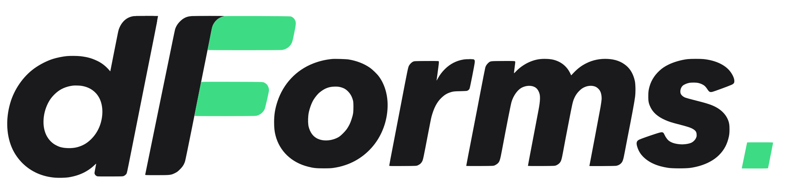
    </picture>
  </a>
</p>

<p align="center"><strong>Open-source forms that qualify, score and route your leads.</strong><br />
Build a multi-step form, score every answer, book the meeting and sync the lead to your CRM. Self-host it anywhere.</p>

<p align="center">
  <a href="https://github.com/Dapta-Tech/dapta-forms/actions/workflows/ci.yml"></a>
  <a href="LICENSE"></a>
  
  
  
  
  
  
  <a href="CONTRIBUTING.md"></a>
</p>

<p align="center">
  <a href="https://dforms.ai">Website</a> ·
  <a href="#quickstart">Quickstart</a> ·
  <a href="SELF-HOSTING.md">Self-hosting</a> ·
  <a href="CONTRIBUTING.md">Contributing</a>
</p>


## What is dForms?

**dForms is a form builder for teams that sell.** A respondent answers a few
questions; dForms scores each answer, decides which outcome they reach (a thank-you
message, a redirect, or a calendar to book a call), and delivers the lead to HubSpot
or any webhook. You see where people drop off and which answers convert.

It is a Turborepo monorepo: a **Next.js 16** web app (public forms, admin and
builder) and a **NestJS** API. **Postgres** is the source of truth in CI and
production; **SQLite** lets you clone and run it in a minute with no infrastructure.

<table>
  <tr>
    <td width="50%">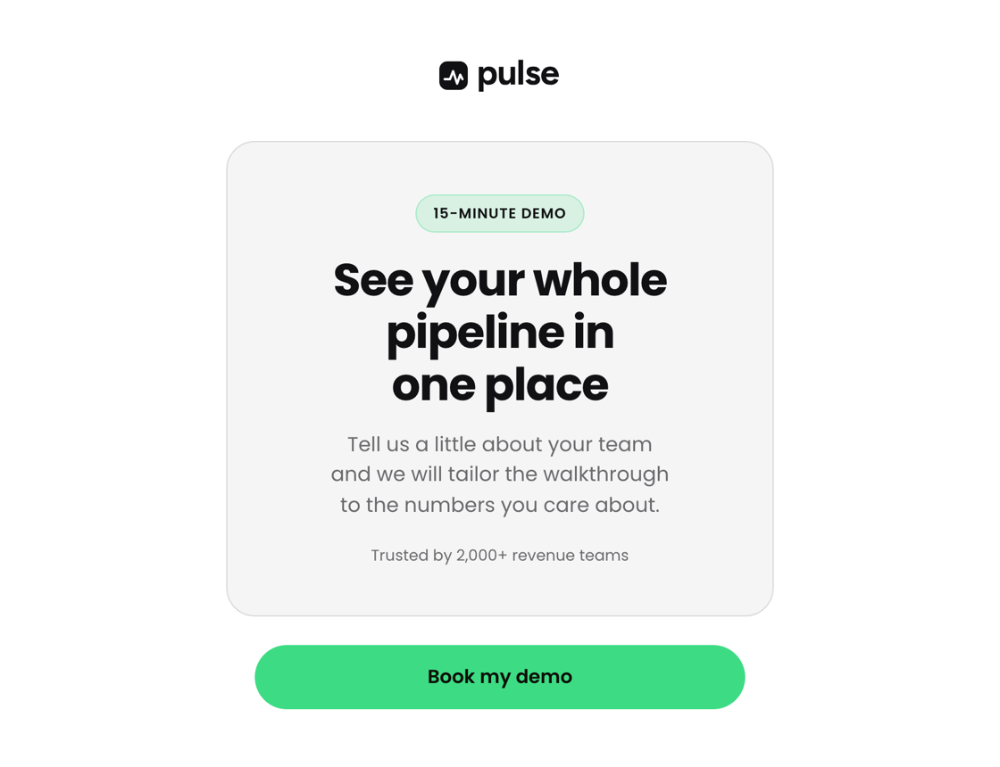</td>
    <td width="50%">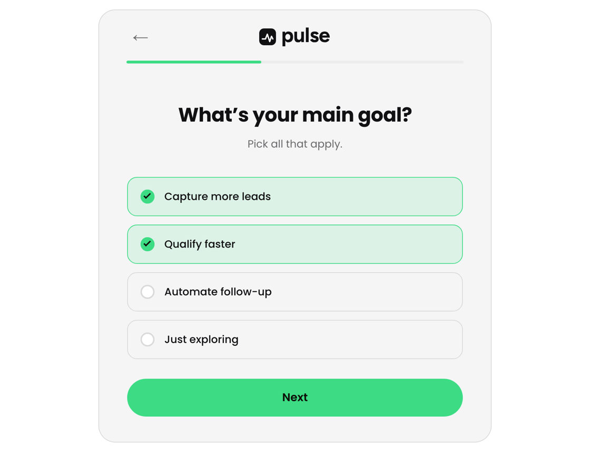</td>
  </tr>
  <tr>
    <td align="center"><p>The public form, in the author's own brand</p></td>
    <td align="center"><p>One question per screen, keyboard-friendly</p></td>
  </tr>
</table>


https://github.com/user-attachments/assets/cf1985d2-63d9-4e68-8395-d8e647730503


## Features

| | |
|---|---|
| **Build** | 13 question types: short and long text, name, email (with a work-email check), phone, URL, dropdown, single and multiple choice (list or cards, with emoji or logos), slider, file upload, message, reveal screen and an embedded scheduler. Slides or one-page layout, live WYSIWYG canvas, desktop and mobile preview. |
| **Logic** | Show/hide conditions and jumps on any answer, numeric operators (equal, greater, less, between), hidden fields filled from `?param=value`, and `@` recall of earlier answers in question text. A visual map of the whole flow. |
| **Score and route** | Points per option (negatives allowed), per-question scoring switch and score ranges mapped to outcomes. Each outcome shows its own message, redirects, or opens a booking step (HubSpot Meetings or Calendly). |
| **Capture** | Partial submissions from a point you choose, one submission per session (upgraded in place when the respondent finishes), and file answers with permanent signed links. |
| **Integrations** | HubSpot (contact upsert, note on the contact, a mirrored HubSpot form submission for attribution), signed JSON webhooks (HMAC-SHA256), owner and respondent emails with editable templates. Every delivery goes through a durable outbox with retries and a visible delivery history. |
| **Tracking** | Per-form Google Tag Manager, Meta Pixel, PostHog and HubSpot tracking code. UTM parameters are captured automatically and can be mapped to CRM properties. |
| **Design** | Theme presets, any brand color, 9 font families or your own font, background styles, corner radius, button and progress styles, logo, cover screen with badge, headline and trust line, and a workspace brand kit. |
| **Analytics** | Views, starts, submissions, completion rate, time to complete, partial submits, daily trends and question-by-question drop-off. |
| **Share** | Readable links (`/{account}/f/{slug}`) with editable slugs, a QR code, and an `embed.js` helper that auto-resizes iframes and carries redirects to the host page. |
| **Operate** | Responses table with header filters, search, time zone and CSV export; folders; workspaces with members and roles; Cloudflare Turnstile spam protection; English and Spanish across the app and the forms. |

## Screenshots

<table>
  <tr>
    <td width="50%">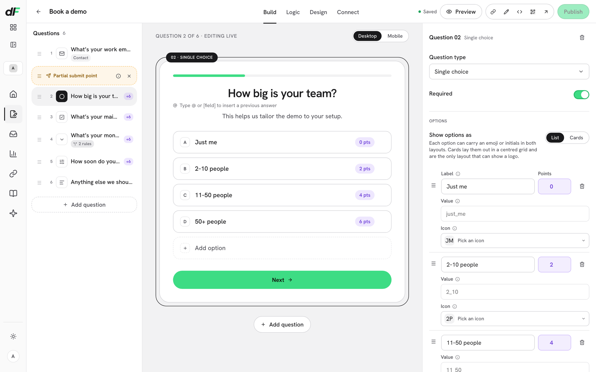<p><b>Build.</b> Questions, live canvas and per-question settings, with points on every option.</p></td>
    <td width="50%">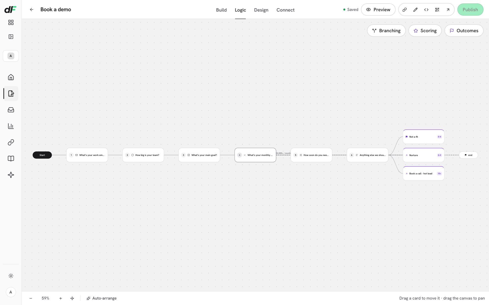<p><b>Logic.</b> The whole flow on one canvas, branching into scored outcomes.</p></td>
  </tr>
  <tr>
    <td>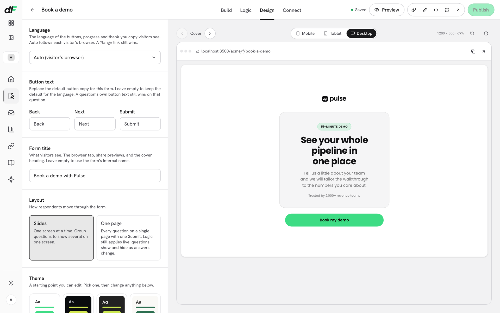<p><b>Design.</b> Language, layout, theme and brand, with a live device preview.</p></td>
    <td>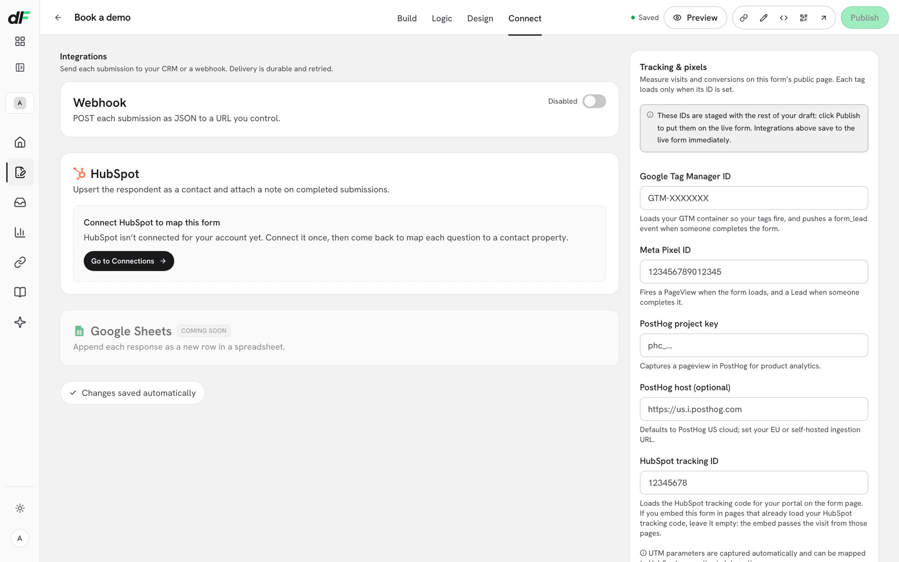<p><b>Connect.</b> Webhook, HubSpot and tracking pixels per form.</p></td>
  </tr>
  <tr>
    <td>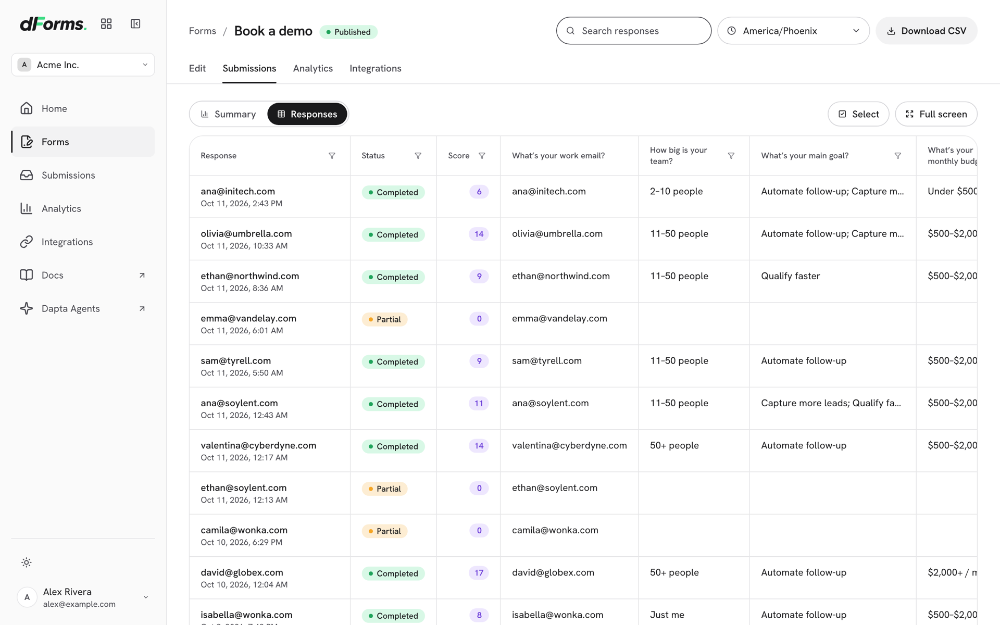<p><b>Submissions.</b> Complete and partial responses with their score, filters and CSV export.</p></td>
    <td>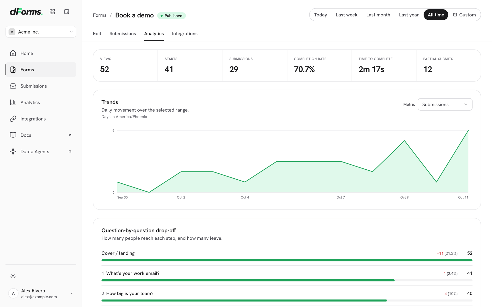<p><b>Analytics.</b> Funnel metrics, daily trends and question-by-question drop-off.</p></td>
  </tr>
  <tr>
    <td>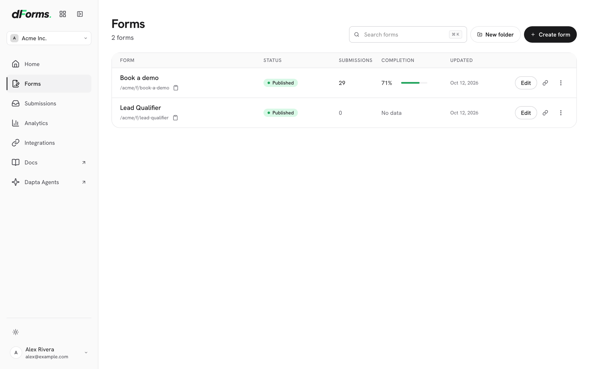<p><b>Forms.</b> Every form with its status, submissions and completion rate.</p></td>
    <td align="center">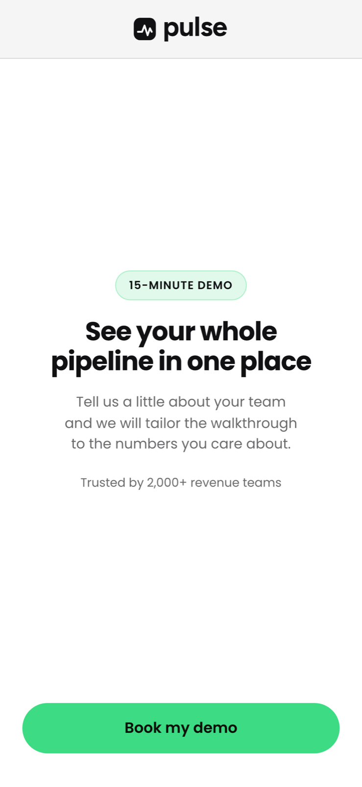<p><b>Mobile.</b> The same form, sized for a phone.</p></td>
  </tr>
</table>

<sub>The brand in these screenshots, "Pulse", is fictional, and so are the respondents.</sub>

## Quickstart

```bash
git clone https://github.com/Dapta-Tech/dapta-forms.git dforms && cd dforms
pnpm install          # Node >= 20.9, pnpm >= 10
pnpm dev              # builds packages, creates and seeds a SQLite DB, starts both apps
```

Then open:

- **Web**: http://localhost:3000, with a seeded demo form at
  [`/acme/f/lead-qualifier`](http://localhost:3000/acme/f/lead-qualifier). The
  admin at `/admin` signs you in as the seeded demo user.
- **API**: http://localhost:4000/health, and the API reference at
  http://localhost:4000/docs (raw spec at `/openapi.json`).

No Docker, no Postgres, no accounts. The database is a file at `.data/dev.db`,
email is `log-only` (notices print to the API log), and `pnpm db:reset` restores
the demo data.

### Two dev modes

| Mode | Command | Database | Use it for |
|---|---|---|---|
| **Fast** | `pnpm dev` | SQLite file (`.data/dev.db`) | Zero-infra onboarding |
| **Parity** | `pnpm dev:pg` | Postgres in Docker | The same engine as CI and production |

`pnpm dev:pg` starts Postgres from `docker-compose.yml`, migrates, seeds and runs
both apps against it. If port 5432 is taken, run `PG_PORT=5433 pnpm dev:pg`.
Ports, Windows shells and running each app on its own are covered in
[`CONTRIBUTING.md`](CONTRIBUTING.md).

## Architecture

```
apps/
  web/            Next.js 16 (App Router, RSC): public forms, admin, builder
  api/            NestJS: public + admin API, outbox worker, OpenAPI
packages/
  engine/         pure form logic: skip-logic, validation, scoring, outcomes (no I/O)
  types/          zod contracts shared by web and api (form config v1, submissions, events)
  db/             Drizzle schema for Postgres and SQLite, migrations, seed, repositories
  destinations/   SubmissionDestination port + webhook, HubSpot and log-only adapters
  notifications/  EmailProvider port + log-only, noop, SMTP and HTTP adapters
  shared/         i18n (EN/ES), handle utils, growth attribution, design tokens
  config/         zod env schema + shared tsconfig and prettier presets
```

- **The web app reaches the API only over HTTP**, so the two deploy independently.
- **The engine is pure and shared**, so the client preview and the server verdict
  always agree. Scores are always recomputed on the server.
- **One submission per session** is enforced twice: an app-level upsert and a
  unique index on `(form_id, session_id)` on both dialects. CI asserts it on
  Postgres on every PR.
- **Side effects go through an outbox**: emails, webhooks and CRM syncs are
  enqueued in the same transaction and drained with retries and backoff.
- **Every integration sits behind a port** (auth, email, destinations, storage,
  captcha) and falls back to a safe no-op, so a bare fork runs with nothing configured.

[`ARCHITECTURE.md`](ARCHITECTURE.md) has the request-flow diagram and the
package boundaries.

## Configuration

Every variable has a safe default; [`.env.example`](.env.example) documents all of
them. Copy it to `.env` to override (a real environment variable always wins).

| Variable | Default | What it does |
|---|---|---|
| `DATABASE_URL` | `file:./.data/dev.db` | A `postgres://` URL switches to Postgres |
| `PUBLIC_APP_URL` | _(empty)_ | The public URL of the web app; set it on every real deploy |
| `API_URL` | `NEXT_PUBLIC_API_URL` | Where the web **server** reaches the API, read at runtime |
| `NEXT_PUBLIC_API_URL` | `http://localhost:4000` | Where the **browser** reaches the API, baked in at build time |
| `AUTH_PROVIDER` | `local` | `local` stub for dev, or `workos` |
| `EMAIL_PROVIDER` | `log-only` | `noop`, `smtp` or `http` |
| `HUBSPOT_PRIVATE_APP_TOKEN` | _(empty)_ | Enables the HubSpot destination |
| `CALENDLY_API_TOKEN` | _(empty)_ | Enriches bookings made through Calendly |
| `STORAGE_BUCKET` | _(empty)_ | Any S3-compatible bucket; enables file uploads |
| `CAPTCHA_SITE_KEY` / `CAPTCHA_SECRET_KEY` | _(empty)_ | Both set enables Cloudflare Turnstile |

When one Docker image is promoted across environments, set `API_URL` per
environment: `NEXT_PUBLIC_*` values are frozen into the image at build time.

## Scripts

| Command | What it does |
|---|---|
| `pnpm dev` / `pnpm dev:pg` | Build packages, migrate and seed, run web and api (SQLite / Postgres) |
| `pnpm build` | Build every package and both apps |
| `pnpm test` | Unit tests across the workspace (Vitest) |
| `pnpm typecheck` / `pnpm lint` | Type-check / lint the workspace |
| `pnpm qa` | End-to-end tests with Playwright |
| `pnpm db:migrate` / `pnpm db:seed` / `pnpm db:reset` | Database lifecycle |

`pnpm dev` migrates before it starts the apps. If you start an app by hand against
a fresh database, run `pnpm db:migrate` first.

## Deploy

dForms runs anywhere Node or Docker runs; it uses no host-specific APIs.

- `apps/web/Dockerfile` builds a Next.js standalone image and `apps/api/Dockerfile`
  the API image. Point `DATABASE_URL` at Postgres.
- `docker-compose.prod.yml` is a production-shaped smoke test: Postgres, a one-shot
  migration, the API and the web app.

**[`SELF-HOSTING.md`](SELF-HOSTING.md)** is the full guide: building the images,
the complete environment reference, reverse proxy and TLS, auth, email and
destination options, upgrades, rollback and troubleshooting.

## Embedding a form

Open any form with `?embed=1` inside an iframe and load the helper next to it:

```html
<iframe data-dapta-forms src="https://your-host/acme/f/book-a-demo?embed=1"
        title="Book a demo" loading="lazy"
        style="width:100%;border:0;min-height:480px;"></iframe>
<script src="https://your-host/embed.js" async></script>
```

The helper resizes the iframe to fit, follows the form's end-of-form redirect on the
host page, and passes the host page's visit along for attribution.

## Documentation

| Document | For |
|---|---|
| [`SELF-HOSTING.md`](SELF-HOSTING.md) | Running dForms in production |
| [`ARCHITECTURE.md`](ARCHITECTURE.md) | Request flow, package boundaries, ports and adapters |
| [`CONTRIBUTING.md`](CONTRIBUTING.md) | Local setup, commit conventions, PR checks |
| [`SPEC-METRICS.md`](SPEC-METRICS.md) | How every analytics metric is defined |
| [`SECURITY.md`](SECURITY.md) | Reporting a vulnerability (never in a public issue) |
| [`CLAUDE.md`](CLAUDE.md) | Guide for AI coding agents: invariants, commands, file pointers |

## Contributing

Read [`CONTRIBUTING.md`](CONTRIBUTING.md). In short:

- Every commit is DCO-signed: `git commit -s`.
- PR titles follow Conventional Commits (`feat:`, `fix:`, `docs:` and so on).
- CI must be green: lint, typecheck, tests on SQLite, the Postgres parity job, a
  full build, the secret scan and the punctuation check (`bash scripts/dash-check.sh`).
- A change to a published package's behavior ships a changeset (`pnpm changeset`).

Working with Claude Code or another AI agent? [`CLAUDE.md`](CLAUDE.md) is loaded
automatically, and `.claude/agents/` ships a read-only **forms-reviewer** and a
**forms-contributor** agent.

> The internal packages use the `@quill/*` scope. Quill is the codename; the
> product is dForms.

## For the Dapta team

The hosted product at [dforms.ai](https://dforms.ai) is built from this repo.

- **Branches.** Feature PRs target `develop`. A release is a PR from `develop` into
  `main`, merged with a **merge commit**, never squashed, so both branches keep the
  same history.
- **Changesets.** Changesets in `.changeset/` become the public CHANGELOG when the
  release workflow runs on `main`. They are public text: no internal names, hosts or
  em dashes.
- **Environments.** `develop` deploys to the dev environment automatically.
  Production is a manual promotion after the release PR is merged. Database
  migrations run on their own during the deploy.
- **Before the release PR**, run `bash scripts/dash-check.sh origin/main` and fix
  what it reports in a small PR to `develop` first.

## License

[MIT](LICENSE) © 2026 Dapta.
